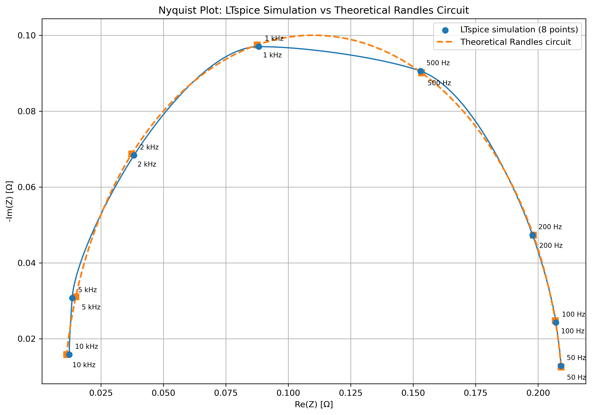
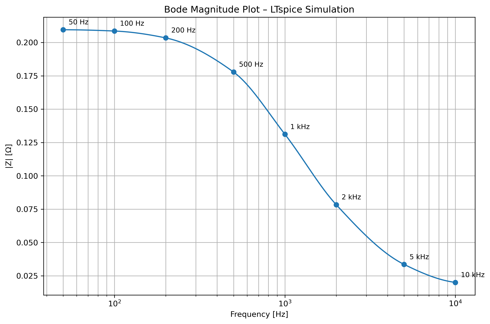
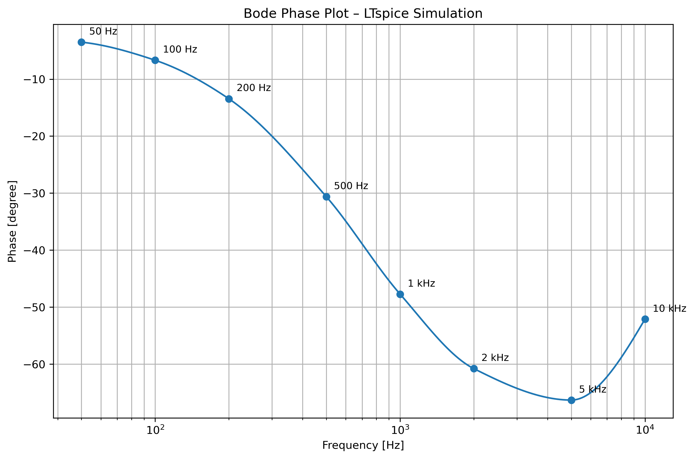

# EIS Measurement System Using a Randles Equivalent Circuit

Simulation and analysis of an electrochemical impedance spectroscopy (EIS)
measurement chain for batteries. The circuit is simulated in LTspice and the
impedance is calculated from the FFT in Python.

## What it does
- A stepped-sine current of 0.5 A drives a Randles equivalent circuit. It uses 8 frequencies from 50 Hz to 10 kHz, with 5 periods each. The circuit has Rs = 0.01 ohm, Rp = 0.20 ohm and Cp = 1 mF.
- An op-amp difference amplifier with unity-gain buffers measures the cell voltage without loading it.
- A Python script reads the exported FFT data, calculates Z = V / I at each frequency, and compares it with the analytical Randles impedance.
- It produces a Nyquist plot, Bode magnitude and phase plots, and a CSV comparison table.

## Result
| Frequency range | Deviation of \|Z\| from theory |
|---|---|
| 50 Hz to 2 kHz | 0.2 % or less |
| 5 kHz and 10 kHz | -2.6 % and +3.3 % |

The larger errors at 5 and 10 kHz come from the analysis method, not the
circuit: each tone lasts only 1 ms and 0.5 ms inside a 194 ms FFT window.
The same deviation appears when the analysis is run on a mathematically
perfect Randles circuit.

This is a simulation with ideal op-amp models and has not yet been measured on hardware.

## How to run
1. Download this repository (Code -> Download ZIP) and keep the folder structure.
2. Install the requirements: `pip install numpy matplotlib scipy` (SciPy is optional and only smooths the curves).
3. Run `scripts/nyquist_plot_n004(1).py`, for example in Spyder.

The script reads `data/Draft5_n004.txt`, saves the CSV in `data/` and the plots in `results/`.
To re-create the data, open `simulation/eis_randles_circuit.asc` in LTspice, run the transient simulation, and export the FFT of V(n004) and I(I1).

## Possible next steps
- Per-segment FFT to remove leakage between tones
- Real op-amp and ADC models
- Build the circuit on a PCB and compare measurement with simulation

## Repository structure
- `simulation/` LTspice schematic (`eis_randles_circuit.asc`)
- `data/` exported FFT data and result CSV
- `scripts/` Python analysis (`nyquist_plot_n004(1).py`)
- `results/` Nyquist, Bode and FFT plots

## Tools
LTspice, Python (NumPy, Matplotlib), FFT analysis, op-amp circuit measurement circuit

Author: Adithya Pushpavanam, M.Sc. Embedded Systems, TU Chemnitz
